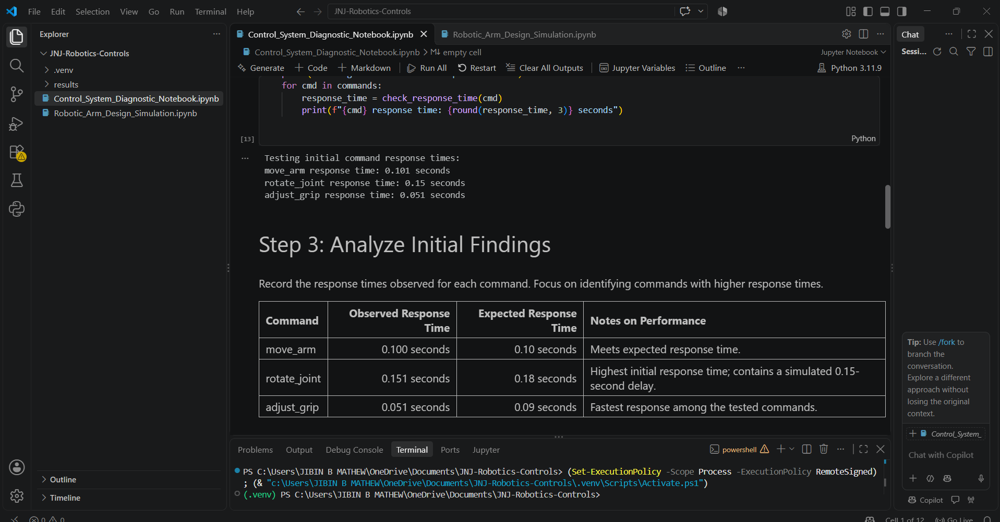
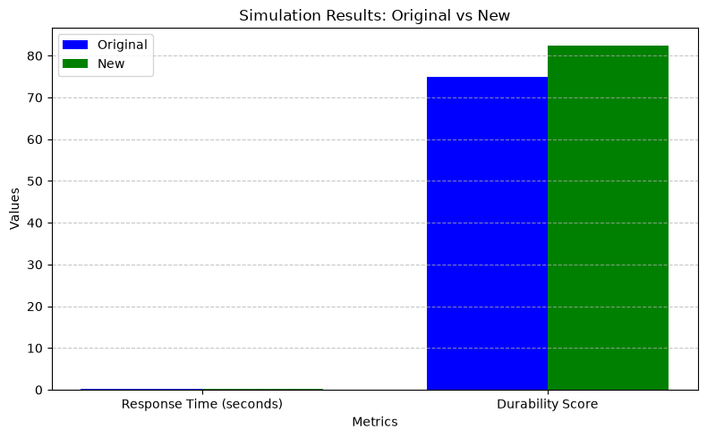
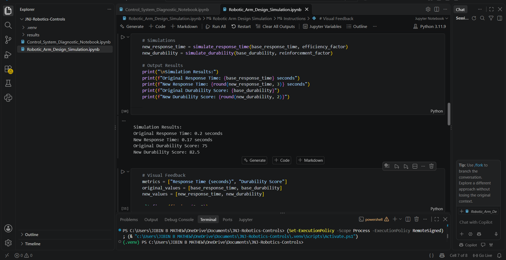

# Robotics & Controls | Surgical Arm Design Optimization

<p align="center">
  <strong>Control System Diagnostics · Python Simulation · Design Optimization</strong>
  <br />
  An engineering portfolio project exploring robotic arm responsiveness, actuator efficiency, and modeled durability.
</p>

<p align="center">
  
  
  
  
  
</p>

---

## Overview

This repository documents my work and learning from the **Johnson & Johnson MedTech Robotics & Controls Job Simulation on Forage**.

The project explores a simplified robotic arm control system through Python-based diagnostics and design optimization. It examines command response times, evaluates mathematical efficiency and reinforcement factors, visualizes modeled results, and documents potential engineering improvements.

The objective is to understand how systematic diagnosis, numerical analysis, and clear technical documentation can support engineering decisions.

> **Project context:** This is an independent educational portfolio project based on a virtual job simulation. It is not an official Johnson & Johnson deliverable and does not represent testing or modification of a real surgical robot.

## Project Objectives

- Measure the response times of simulated robotic arm commands.
- Identify the command with the highest measured baseline response time.
- Analyze the simulated delay in the command execution path.
- Evaluate the modeled effects of efficiency and reinforcement factors.
- Visualize initial and optimized performance metrics.
- Document proposed improvements and their limitations.

## Technology Stack

| Technology | Application |
|---|---|
| Python | Diagnostic logic and simulation functions |
| NumPy | Numerical operations and plotting support |
| Matplotlib | Simulation result visualization |
| Jupyter Notebook | Interactive code execution and analysis |
| VS Code | Development and experimentation |

## Repository Structure

```text
JNJ-Robotics-Controls/
│
├── README.md
├── requirements.txt
├── .gitignore
│
├── Control_System_Diagnostic_Notebook.ipynb
├── Robotic_Arm_Design_Simulation.ipynb
│
└── results/
    ├── diagnostic-results.png
    ├── simulation-results.png
    └── simulation-output.png
```

The `results/` folder contains screenshots or exported figures from my own notebook runs. Include only files that you have actually saved.

## Project Workflow

### 01 — Control System Diagnostics

The diagnostic notebook measures the execution time of three simulated commands:

- `move_arm`
- `rotate_joint`
- `adjust_grip`

The measured response times were compared to identify the slowest command and investigate its execution path.

### 02 — Root Cause Analysis

The `rotate_joint` command had the highest measured baseline response time in the diagnostic exercise.

The command's code path explicitly included a simulated delay using Python's `time.sleep(0.15)`. This provides a direct explanation for the delay within the educational example.

### 03 — Design Optimization Simulation

The design simulation evaluates two configurable factors:

- **Efficiency improvement factor:** 15%
- **Reinforcement factor:** 10%

The model calculates a new response-time value and a new durability score using the supplied baseline values and factors.

### 04 — Visual Analysis

Matplotlib is used to compare the initial and optimized metrics. The chart provides a visual summary of the model's output, while the numerical results provide the precise values.

### 05 — Technical Documentation

The findings were organized into a design optimization proposal covering the problem statement, proposed modifications, simulation results, visual examples, expected outcomes, and conclusion.

## Results & Analysis

### Diagnostic Results

The following values were observed in the Task 1 diagnostic exercise:

| Command | Measured Response Time |
|---|---:|
| `move_arm` | 0.100 s |
| `rotate_joint` | 0.151 s |
| `adjust_grip` | 0.051 s |

**Observation:** `rotate_joint` had the highest measured baseline response time among the three commands tested.

The measured value was approximately 0.151 seconds. The diagnostic exercise included a 0.15-second simulated delay in the corresponding command path.

### Design Simulation Results

The Task 2 design simulation used a separate baseline response time of 0.20 seconds and a durability score of 75.

| Metric | Initial Value | Modeled Result | Change |
|---|---:|---:|---:|
| Response time | 0.20 s | 0.17 s | 15% reduction |
| Durability score | 75 | 82.5 | 10% increase |

#### Response-Time Calculation

The simulation applies a 15% efficiency factor:

```python
new_response_time = base_response_time * (1 - efficiency_factor)
```

With a base response time of 0.20 seconds:

```text
0.20 × (1 − 0.15) = 0.17 seconds
```

The modeled response time decreases by 0.03 seconds.

#### Durability Calculation

The simulation applies a 10% reinforcement factor:

```python
new_durability = base_durability * (1 + reinforcement_factor)
```

With a base durability score of 75:

```text
75 × (1 + 0.10) = 82.5
```

The modeled durability score increases by 7.5 points.

> These are mathematical simulation results. They do not demonstrate that physical actuator upgrades or structural reinforcement have been implemented or tested.

## Visual Results

### 1. Control System Diagnostics

This figure documents the command response-time measurements from the diagnostic notebook.



### 2. Design Optimization Simulation

This figure compares the original and modeled response-time and durability values.



### 3. Python Simulation Output

This screenshot records the numerical output generated by the design simulation in VS Code.



*If a screenshot is unavailable, remove its image reference or save the corresponding file in the `results/` directory before publishing.*

## Proposed Engineering Improvements

The simulation and diagnostic observations informed the following proposed design directions.

| Area | Proposed Action | Intended Benefit |
|---|---|---|
| Command execution | Investigate unnecessary processing overhead and control-path efficiency | Reduce avoidable response delays |
| Actuator and joint structure | Evaluate suitable reinforcement around critical joint areas | Explore improved structural durability |
| Sensor alignment | Assess sensor placement and calibration | Support accurate and timely movement feedback |

These are recommendations for further investigation. The current simulation does not independently validate the physical effectiveness of these changes.

## Key Learning Outcomes

Through this virtual job simulation, I developed experience in:

- **Algorithm Development:** Working with Python functions and control-command logic.
- **Analytical Problem Solving:** Investigating response-time differences and identifying a simulated delay.
- **Analytical Thinking:** Interpreting numerical results and comparing performance metrics.
- **Attention to Detail:** Recording measured values and distinguishing observations from assumptions.
- **Design Iteration:** Evaluating configurable optimization factors.
- **Software Development:** Writing and executing Python code in Jupyter notebooks.
- **Software Testing:** Running diagnostic and simulation cells and examining outputs.
- **Technical Documentation:** Preparing a structured engineering proposal with findings and recommendations.

## Limitations & Validation

This project uses a simplified educational simulation and has several limitations:

1. The Task 1 diagnostic measurements and Task 2 simulation use different baseline response times and must be interpreted separately.
2. The Task 2 response-time improvement is calculated using a mathematical efficiency factor. The simulation does not demonstrate an actual modification to the Task 1 command implementation.
3. The durability score is a modeled metric, not a physical measurement of material strength or component lifespan.
4. Sensor feedback delay and sensor misalignment were not directly quantified in the design simulation.
5. The simulation does not establish clinical safety, surgical precision, or real-world system reliability.

Any real-world engineering implementation would require appropriate design analysis, physical testing, verification, and safety validation.

## How to Run

### Prerequisites

- Python 3.11 or a compatible Python version
- Visual Studio Code
- The Jupyter extension for VS Code

### 1. Clone the repository

Replace the placeholder with your actual GitHub repository URL.

```bash
git clone YOUR_GITHUB_REPOSITORY_URL
cd JNJ-Robotics-Controls
```

### 2. Create a virtual environment

```bash
python -m venv .venv
```

### 3. Activate the environment

**Windows PowerShell**

```powershell
.\.venv\Scripts\Activate.ps1
```

### 4. Install dependencies

```bash
python -m pip install -r requirements.txt
```

### 5. Open the notebooks

Open the repository folder in VS Code, select the virtual environment as the Python kernel, and open either notebook:

- `Control_System_Diagnostic_Notebook.ipynb`
- `Robotic_Arm_Design_Simulation.ipynb`

Run the cells in order, following the notebook instructions.

## Acknowledgment

Completed through the **Johnson & Johnson MedTech Robotics & Controls Job Simulation on Forage**.

This repository presents my independent educational notes, analysis, and project documentation. Johnson & Johnson and Forage names are used solely to identify the learning experience. No affiliation, endorsement, or access to proprietary technology is implied.

---

<p align="center">
  <strong>Diagnose. Analyze. Simulate. Document.</strong>
  <br />
  <sub>A learning project in robotics and controls engineering.</sub>
</p>